<div align="center">



<a href="https://github.com/tddft64">
  
</a>

<br/>


</div>


### ▸ IDENTIFICAÇÃO DO PROGRAMA

```yaml
programa:      thiago.exe
classe:        físico computacional · dev · professor
compilado_em:  Quantum Monte Carlo
setor_atual:   educação a distância      # 12 ciclos rodando na Grade
ensina:        [Inteligência Artificial e qualquer coisa com números]
turno_noturno: agentes de IA codando enquanto eu durmo
pilota:        Omega Suprema 1993, a álcool   # placa preta, respeite
sonha_com:     comprar uma fazenda e nunca mais pegar num computador :)
diretiva:      lutar pelos usuários
```

### ▸ LOGS DA GRADE

```diff
+ A inteligência artificial não deve te dar uma nova habilidade... Ela tem que potencializar
+ as que você já tem.

+ Já simulei elétrons com Monte Carlo quântico. Hoje simulo calendário acadêmico.
+ O segundo tem mais variância.

+ Ensino exatas, então sei exatamente o quão improvável é um deploy de sexta dar certo.
- Faço mesmo assim.

+ 12 anos de EaD: vi o LMS evoluir de "repositório de PDF" para experiência de aprendizagem.

+ Meus agentes trabalham no turno da noite. Eu acordo e faço code review.
@@ A inteligência é artificial. A responsabilidade continua sendo minha. @@
```


### ▸ ARSENAL

<div align="center">

<sub><code>LINGUAGENS</code></sub><br/>


<br/><br/>

<sub><code>SISTEMAS</code></sub><br/>


</div>


### ▸ TELEMETRIA

<div align="center">


</div>

### ▸ MOTO DE LUZ × CONTRIBUIÇÕES

<div align="center">


</div>


### ▸ CANAL DE COMUNICAÇÃO

<div align="center">

<!-- Contatos: troque SEU_LINKEDIN e SEU_EMAIL e remova este comentário para ativar
<a href="https://www.linkedin.com/in/SEU_LINKEDIN"></a>
<a href="mailto:SEU_EMAIL"></a>
-->
<a href="https://github.com/tddft64"></a>

<br/><br/>

<sub><code>&gt; conexão encerrada pelo programa thiago.exe</code></sub>
<br/>
<sub><b>END OF LINE.</b></sub>

</div>
